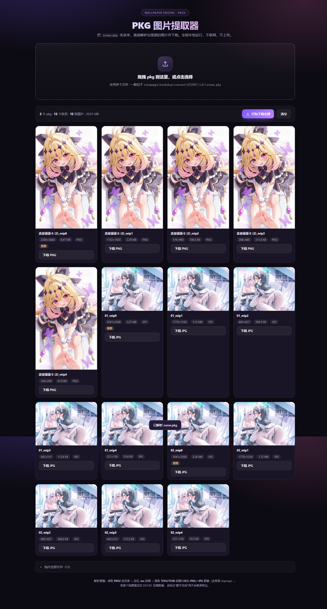

# PKG 图片提取器 · Wallpaper Engine

把 Wallpaper Engine 壁纸的 `scene.pkg` 拖进浏览器，直接解析出里面打包的图片并下载。
**纯前端、零依赖、单文件、离线运行** —— 文件只在浏览器内存里处理，不上传、不联网。

Extract images embedded in Wallpaper Engine `scene.pkg` files, entirely in the browser. No server, no dependencies, no build step required.



## 在线试用

<https://Neri0721.github.io/we-pkg-image-extractor/>

（自己部署的话：Settings → Pages → Deploy from a branch → `main` / `root`，无需构建。）

## 功能

- 解析 `PKGV` 容器条目表，列出包内全部文件（scene.json / materials / models / shaders）
- 从 `.tex` 的 `TEXV` / `TEXB` 容器中提取内嵌的 **PNG** 与 **JPEG** 图像，包含各级 mipmap
- 卡片墙预览、原图标注、点击放大
- 单张下载（保留原始格式，JPEG 不二次压缩）或一键打包 ZIP（保留 pkg 内目录结构）
- 支持多选 / 连续拖入多个 pkg

## 使用

1. 下载或克隆本仓库，双击 `index.html`（推荐 Edge / Chrome / Firefox）
   - 也可以直接 `python build.py` 生成单文件版 `PKG图片提取器.html`，方便单独发送
2. 把 `scene.pkg` 拖进页面中央的虚线框
   - 路径一般在 `steamapps\workshop\content\431960\<创意工坊ID>\scene.pkg`
3. 解析完成后逐张下载，或点「打包下载全部」

## 支持范围

| 项目 | 状态 |
| --- | --- |
| PKGV 容器（实测 `PKGV0024`） | ✅ |
| TEXB 内的 PNG 负载 | ✅ |
| TEXB 内的 JPEG 负载 | ✅ |
| 旧式 DXT1 / DXT3 / DXT5 压缩块（常见于 TEXB0001~0003） | ❌ 标注“暂不支持” |
| BC7 等新式压缩 | ❌ |

遇到不支持的贴图时页面会明确标注，不会导出损坏文件。

## 实现要点

- **pkg**：读取 `PKGV` 魔数、条目数、条目表（长度前缀 + UTF-8 路径 + 相对偏移/长度），数据区偏移以条目表结束处为基准；对少数使用绝对偏移的变体做了兜底判断
- **tex**：不依赖头部字段，直接按签名扫描图像负载
  - PNG：沿 chunk 走到 `IEND`，逐块校验
  - JPEG：按 marker 段解析，进入熵编码区后跳过 `FF00` 填充，直到 `FFD9`（兼容渐进式 JPEG）
- **下载**：Blob URL；ZIP 由内置的 STORE-only writer 生成，UTF-8 文件名标志位已设置
- 全程零第三方库，核心逻辑是普通 `<script>`，因此在 `file://` 下也能直接运行

## 开发

```bash
python build.py      # 把 app.js 内联进 index.html，输出单文件版
node test/test.js    # 运行解析 / 打包单元测试（无依赖）
```

目录结构：

```
index.html            页面
app.js                解析 + 界面逻辑
build.py              单文件构建脚本（Python 3，标准库）
test/test.js          Node 单元测试（构造合成 pkg 验证解析与 ZIP）
使用说明.txt           给普通用户的简短说明
预览.png              截图
```

## 声明

仅用于本地备份你自己已订阅的创意工坊内容。壁纸的版权归原作者所有，请勿二次分发或商用；使用前请遵守 Steam 创意工坊的相关条款。

## License

[MIT](LICENSE)
